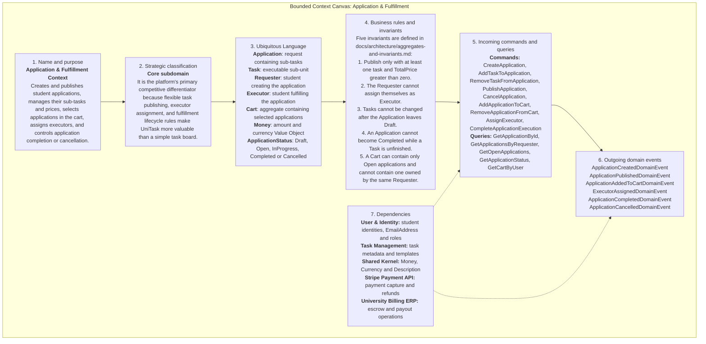
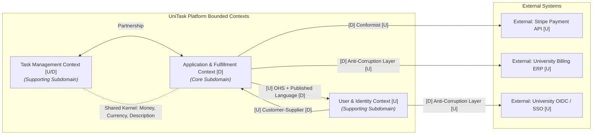
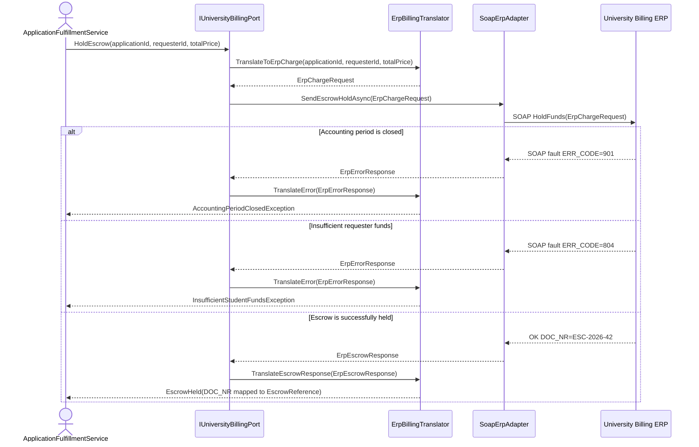

# Strategic Architecture: Subdomains, Bounded Contexts, Context Map, and ACL Specification (UniTask)

This document describes the strategic architecture for the **UniTask** student platform based on Domain-Driven Design (DDD) principles. It synthesizes the domain modeling from Lab 1 (Event Storming) and Lab 2 (Aggregates, Invariants, and Value Objects) into strategic subdomain classifications, a Bounded Context Canvas, a Context Map, and a formal Anti-Corruption Layer (ACL) specification.

---

## 1. Step 1 — Subdomain Classification & Core Context Canvas

### 1.1 Subdomain Classification Table

The **UniTask** platform is divided into three primary internal Bounded Contexts and integrated with external systems. Each context fulfills a distinct role in the business ecosystem.

| Context Name | Subdomain Classification | Key Aggregates & Entities | Business Justification | Module Microarchitecture |
| :--- | :--- | :--- | :--- | :--- |
| **`Application & Fulfillment Context`** | **Core** | `Application` (Aggregate Root), `Cart` (Aggregate Root), `Task` (Internal Entity), `Requester` (Role Entity), `Executor` (Role Entity) | Flexible publishing of student task applications, shopping-cart application grouping, executor assignment, and execution lifecycle management form UniTask's primary market differentiator and competitive advantage over static calendars or generic task boards. | **Rich Domain Model + Hexagonal / Clean Architecture**: Complex multi-state invariants, self-assignment rules, and price calculations are encapsulated within domain aggregates and protected from external infrastructure. |
| **`Task Management Context`** | **Supporting** | `Task` (Aggregate Root / Catalog Item), `TaskCost` (Entity/VO), `TaskTitle` (VO), `TaskDescription` (VO) | Manages task taxonomy, category definitions, standard templates, and individual sub-task price guidelines. Necessary for structuring requests, but does not independently provide a competitive advantage. | **CQRS / Transaction Script Architecture**: Lightweight application services executing validation rules with separate read projections for catalog searches. |
| **`User & Identity Context`** | **Supporting** | `User` (Aggregate Root), `EmailAddress` (VO), `PasswordHash` (VO), `FullName` (VO), `StudentRole` (Entity) | Manages student registration, academic email verification, user profiles, and role management (`Requester`, `Executor`, `Admin`). Essential for operational trust and identity verification. | **Identity Adapter + Transaction Script**: Thin domain encapsulation wrapping identity providers, managing claims, and exposing user identity state. |
| **`Payment & Escrow Integration`** | **Generic** | `Payment` (Entity), `EscrowTransaction` (Entity), `PlatformFee` (VO) | Escrow hold management, credit card payments, payout releases, and platform fee deductions follow standard financial accounting patterns. Delegated to external payment gateways. | **Adapter / Gateway Architecture**: Infrastructure integration wrappers and DTO translators mapping internal payment commands to external APIs. |

---

### 1.2 Bounded Context Canvas: Application & Fulfillment Context



| Canvas block | Application & Fulfillment Context |
|---|---|
| **Name and purpose** | Manage the lifecycle of student applications: create, compile sub-tasks, publish, cart-select, assign an executor, execute, complete, and cancel. |
| **Strategic classification** | **Core subdomain**. Its lifecycle rules and anti-fraud/peer-execution safeguards provide UniTask's main competitive advantage. |
| **Ubiquitous Language** | `Application`, `Task`, `Requester`, `Executor`, `Cart`, `Money`, `ApplicationId`, `TaskId`, `ApplicationTitle`, `Description`, and `ApplicationStatus`. |
| **Business rules** | The `Application` and `Cart` invariants in [aggregates-and-invariants.md](aggregates-and-invariants.md), including empty-application publication, self-assignment, post-Draft modification, unfinished-task completion, and invalid cart selection. |
| **Incoming commands** | `CreateApplication`, `AddTaskToApplication`, `RemoveTaskFromApplication`, `PublishApplication`, `CancelApplication`, `AddApplicationToCart`, `RemoveApplicationFromCart`, `AssignExecutor`, and `CompleteApplicationExecution`. |
| **Incoming queries** | `GetApplicationById`, `GetApplicationsByRequester`, `GetOpenApplications`, `GetApplicationStatus`, and `GetCartByUser`. |
| **Outgoing events** | `ApplicationCreatedDomainEvent`, `ApplicationPublishedDomainEvent`, `ApplicationAddedToCartDomainEvent`, `ExecutorAssignedDomainEvent`, `ApplicationCompletedDomainEvent`, and `ApplicationCancelledDomainEvent`. |
| **Dependencies** | **Upstream/internal:** User & Identity for students and roles; Task Management for task metadata. **External:** Stripe Payment API for payments and University Billing ERP for escrow and payouts. |

---

## 2. Step 2 — Strategic Context Map

### 2.1 Strategic Context Map Diagram

The Context Map below illustrates all internal Bounded Contexts, external systems, connection directions Upstream `[U]` / Downstream `[D]`, and strategic integration patterns.



#### Explicit Shared Kernel Specification
To maintain strict context isolation, the **Shared Kernel** between `Task Management Context` and `Application & Fulfillment Context` contains **only small, stable Value Objects**. No aggregates or entities are shared:
- `Money` (Value Object: amount and currency)
- `Currency` (Value Object / Enum: currency codes like `PLN`, `EUR`)
- `Description` (Value Object: text validation wrapper)

*Explicit Exclusions:* `Application` aggregate, `Task` entity/aggregate, `User` entity, and `Cart` aggregate are strictly isolated within their respective contexts.

---

### 2.2 Connection Justification Table

The table below provides business and technical justifications for each strategic relationship in the Context Map.

| Connection | Upstream [U] / Downstream [D] | Integration Pattern | Dictating Side | Business & Architecture Justification | Primary Risk Involved |
| :--- | :--- | :--- | :--- | :--- | :--- |
| **Task Management <--> Application & Fulfillment** | Symmetric `[U]` / `[D]` | **Partnership** | Mutual Cooperation | Both teams must co-evolve task templates and application fulfillment rules. Changes in sub-task price structures directly impact application total price calculation invariants. | Coupling between release cycles; changes in task structure can break application creation flows if teams fail to coordinate. |
| **Task Management <--> Application & Fulfillment (Kernel)** | Symmetric | **Shared Kernel** | Mutual Agreement | Small, immutable Value Objects (`Money`, `Currency`, `Description`) are shared to prevent redundant code while ensuring consistent financial and text formatting across catalog and execution bounded contexts. | Risk of "bloat" if developers accidentally add domain logic or entities to the Shared Kernel, leaking context boundaries. |
| **User Identity [U] --> Application & Fulfillment [D]** | `User Identity [U]`<br/>`App Fulfillment [D]` | **Customer–Supplier** | Downstream (Customer dictates needs) | `Application & Fulfillment` requires identity validation (e.g. checking whether a student is banned or eligible to execute tasks). `User Identity` acts as a supplier, prioritizing downstream interface requests. | Downstream can become blocked if Upstream fails to deliver requested identity profile API features on schedule. |
| **University Billing ERP [U] --> Application & Fulfillment [D]** | `Uni ERP [U]`<br/>`App Fulfillment [D]` | **Anti-Corruption Layer (ACL)** | Upstream (Legacy system dictates legacy schema) | The legacy university ERP uses outdated SOAP DTOs, numeric error codes (`901`, `804`), and integer kopecks (`KWOTA_GROSZA`). An ACL translates legacy data into UniTask domain types (`Money`, domain exceptions) to protect the core model from corruption. | High maintenance overhead if the legacy ERP introduces unannounced API schema changes or new obscure error codes. |
| **Stripe Payment API [U] --> Application & Fulfillment [D]** | `Stripe API [U]`<br/>`App Fulfillment [D]` | **Conformist** | Upstream (Stripe dictates API) | Stripe provides a standard checkout session API. Because Stripe's payload model is clean and widely adopted, `Application & Fulfillment` conforms directly to Stripe's payment session DTO without building an elaborate custom domain wrapper. | Vendor lock-in to Stripe's payment DTO structure and breaking changes in external Stripe API versions. |
| **Application & Fulfillment [U] --> Subscriber Services [D]** | `App Fulfillment [U]`<br/>`Subscribers [D]` | **Open Host Service + Published Language (OHS/PL)** | Upstream (Core context publishes event schema) | `Application & Fulfillment` exposes domain events (`ApplicationPublishedDomainEvent`, `ApplicationCompletedDomainEvent`) via a stable event contract. Downstream listeners (notification services, user metrics) consume published events asynchronously. | Event schema versioning risk; breaking updates to published events require subscribers to update their event consumers. |
| **University OIDC/SSO [U] --> User Identity [D]** | `Uni SSO [U]`<br/>`User Identity [D]` | **Anti-Corruption Layer (ACL)** | Upstream (SSO Provider) | `User Identity` translates SAML2/OIDC claims from the university SSO into internal `UserId` and `EmailAddress` Value Objects, insulating UniTask from university identity provider changes. | Identity token parsing failures or SAML protocol deprecations from university IT management. |

---

## 3. Step 3 - Anti-Corruption Layer Specification

### 3.1 Selected integration

The selected relationship is **University Billing ERP [U] -> Application & Fulfillment [D]**. The ERP is a legacy upstream system, so it must not provide raw SOAP fields, integer account codes, string amounts, or ERP error numbers to the core domain.

The boundary is implemented as:

**Domain Port -> Translator -> Communication Adapter -> University Billing ERP**

- The application fulfills this integration through a domain port expressed in UniTask vocabulary.
- `ErpBillingTranslator` converts ERP DTOs and error codes into UniTask domain types.
- `SoapErpAdapter` performs the actual SOAP communication.
- The ERP exposes only through the adapter and never enters the domain model.

### 3.2 Flow diagram



### 3.3 Domain port and C# signature

The port is named `IUniversityBillingPort`. It belongs to the Application & Fulfillment domain and exposes only UniTask domain types:

```csharp
namespace UniTask.ApplicationFulfillment.Domain.Ports;

public interface IUniversityBillingPort
{
    Task<EscrowReceipt> HoldEscrowAsync(
        Guid applicationId,
        Guid requesterId,
        Money totalPrice,
        CancellationToken cancellationToken = default);
}

public sealed record EscrowReceipt(
    EscrowReference Reference,
    EscrowStatus Status);

public sealed record EscrowReference(string Value);
```

The ERP is responsible for no domain concepts here. In particular, `KWOTA_GROSZA`, `KOD_STUDENTA`, and `ERR_CODE` remain outside the domain port and are introduced only inside `ErpBillingTranslator`.

### 3.4 Foreign-to-domain mapping

| Foreign ERP field or error code | UniTask model equivalent | Translation |
|---|---|---|
| `KWOTA_GROSZA` - a string amount in grosze, for example `"12000"` | `Money` **Value Object from Lab 2** | Divide by `100`, parse as `120.00m`, and create `Money` with amount `120.00` and currency `PLN`. The ERP integer/grosze representation never leaks into `Application.TotalPrice` or `Cart.TotalCartPrice`. |
| `KOD_STUDENTA` - for example `"STUD-2026-4412"` | `Guid requesterId` | Strip the ERP prefix and convert the remaining identifier to the `Guid` requester ID used by the `Application` aggregate. The port can later replace this primitive with a dedicated `UserId` Value Object without changing the ERP boundary. |
| `DOC_NR` - for example `"ESC-2026-42"` | `EscrowReceipt` and `EscrowReference` | Map the ERP document number to a domain escrow receipt instead of exposing the ERP string as the application result. |
| `ERR_CODE=901` - accounting period closed | `AccountingPeriodClosedException` | Translate the foreign numeric code into a domain exception with a clear UniTask business meaning. |
| `ERR_CODE=804` - insufficient student funds | `InsufficientStudentFundsException` | Translate the ERP balance fault into an exception that the Application Fulfillment application layer can handle without knowing ERP codes. |

This ACL protects the core invariant that a student's application and cart use validated `Money` Value Objects and that ERP outages or payment failures do not spread foreign fault codes through the domain.
