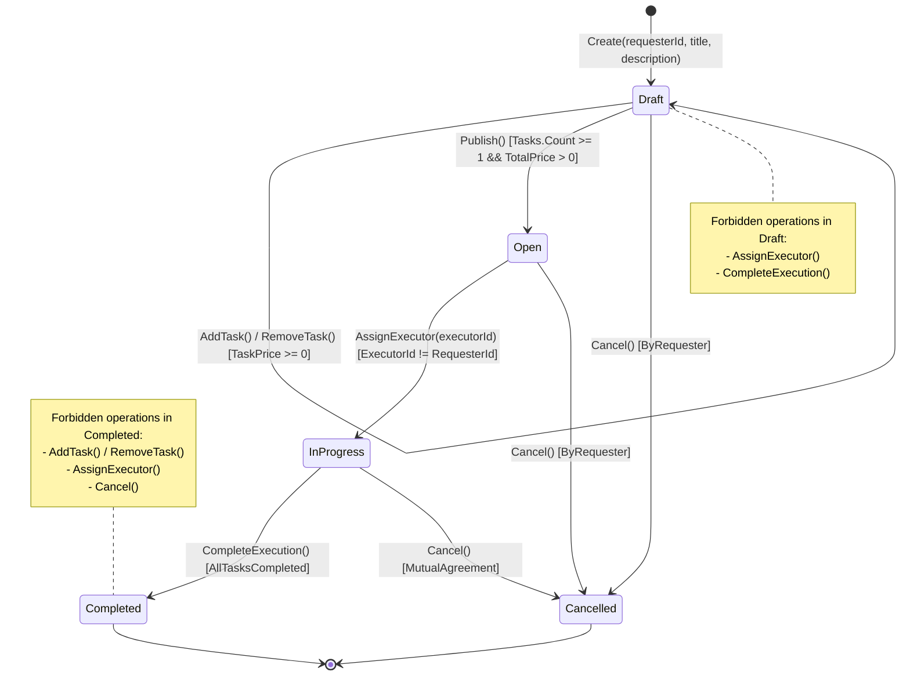

# Business Invariants, Lifecycle State Machine, and Domain Design Pattern (UniTask)

This document defines the lifecycle state machine, domain invariants, TDD test specifications, and GoF design pattern implementation for the **`Application`** aggregate root (a student's task announcement containing one or more sub-tasks) in the **UniTask** platform.

---

## 1. Lifecycle State Machine (`stateDiagram-applicationLifecycle`)

The **`Application`** aggregate moves through 5 distinct business states: `Draft`, `Open`, `InProgress`, `Completed`, and `Cancelled`.

---

## 2. Catalog of Business Invariants

The table below defines 5 genuine domain invariants enforced by the **`Application`** aggregate root (and its related **`Cart`** aggregate), paired with the specific domain exceptions thrown when violated.

| Aggregate Name | Exact Business Rule (Invariant) | Thrown Domain Exception |
| :--- | :--- | :--- |
| **`Application`** | An application cannot be published (`Publish()`) unless it contains at least one sub-task (`_tasks.Count >= 1`) and its total calculated price is strictly greater than zero. | `EmptyApplicationPublishException` |
| **`Application`** | A student who created the application (`RequesterId`) cannot be assigned as the `Executor` of their own application. | `SelfAssignmentNotAllowedException` |
| **`Application`** | Sub-tasks cannot be added, removed, or repriced once the application has left the `Draft` state (`Open`, `InProgress`, `Completed`, or `Cancelled`). | `ApplicationModificationForbiddenException` |
| **`Application`** | An application cannot be marked as `Completed` while any of its internal sub-tasks (`Task`) still remain in an unfinished status. | `IncompleteTasksInApplicationException` |
| **`Cart`** | A user cannot add an `Application` to their `Cart` if the application is not in the `Open` state or if the user is the original `Requester` of that application. | `InvalidCartApplicationSelectionException` |

---

## 3. Given–When–Then Specification for TDD Tests

### Scenario 1: Positive — Publishing a Valid Application
* **Given** an `Application` in the `Draft` state created by `StudentA`, containing two `Task` entities priced at `50 PLN` and `70 PLN` (`TotalPrice = 120 PLN`),
* **When** `StudentA` invokes the `Publish()` command,
* **Then** the `Application` transitions to the `Open` state and raises an `ApplicationPublishedDomainEvent`.

### Scenario 2: Positive — Assigning an Eligible Executor
* **Given** an `Application` in the `Open` state owned by `StudentA`,
* **When** `StudentB` (`StudentB != StudentA`) is assigned via the `AssignExecutor(StudentBId)` command,
* **Then** the `Application` transitions to the `InProgress` state and records `StudentBId` as the active executor.

### Scenario 3: Negative — Attempting to Publish an Empty Application
* **Given** an `Application` in the `Draft` state with zero sub-tasks added (`_tasks` is empty),
* **When** the requester invokes the `Publish()` command,
* **Then** the aggregate rejects the state transition and throws an `EmptyApplicationPublishException`.

### Scenario 4: Negative — Attempting to Modify Tasks After Publication
* **Given** an `Application` that has already transitioned to the `Open` state,
* **When** the requester attempts to invoke `AddTask(newTaskTitle, newTaskDesc, newTaskPrice)`,
* **Then** the aggregate protects its invariant and throws an `ApplicationModificationForbiddenException`.